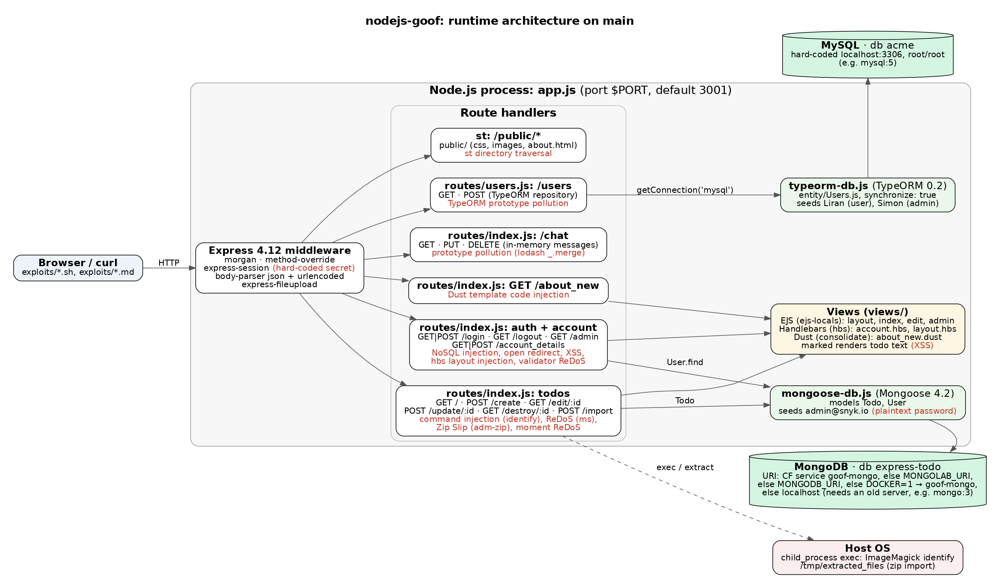

# Architecture

Goof is Snyk's **intentionally vulnerable** Node.js todo app. Everything below describes the code on `main`
as it is, planted vulnerabilities included. They exist for security demos; do not "fix" them here.

The diagram source is [`diagrams/architecture.dot`](diagrams/architecture.dot) (Graphviz). After editing it,
re-render the PNG and SVG with `docs/diagrams/render.sh` (needs `apt-get install graphviz`).

## Components

| Part | File(s) | What it does |
| --- | --- | --- |
| Entry point | `app.js` | Builds one Express 4.12 app, registers three view engines (EJS via `ejs-locals`, Handlebars via `hbs`, Dust via `consolidate`), mounts middleware and routes, and listens on `$PORT` (default `3001`). Requiring `mongoose-db.js` and `typeorm-db.js` opens both database connections at startup. |
| Middleware | `app.js` | `morgan` logging, `method-override`, `express-session` (secret `keyboard cat`, cookie options set only `path`), `body-parser` JSON + urlencoded, `express-fileupload`, `errorhandler` in development. |
| Todo, auth and demo routes | `routes/index.js` | All page handlers except `/users` (see the route table). |
| Users API | `routes/users.js` | Express router mounted at `/users`; reads and writes the MySQL `Users` table through TypeORM. |
| Static files | `st` in `app.js`, `public/` | Serves `public/` under `/public`. |
| Views | `views/` | `layout.ejs`, `index.ejs`, `edit.ejs`, `admin.ejs` (EJS); `account.hbs`, `layout.hbs` (Handlebars); `about_new.dust` (Dust). Todo text is rendered through `marked`. |
| MongoDB access | `mongoose-db.js` | Mongoose 4.2 models `Todo` (`content: Buffer`, `updated_at`) and `User` (`username`, `password`); seeds `admin@snyk.io` / `SuperSecretPassword` in plaintext when missing. |
| MySQL access | `typeorm-db.js`, `entity/Users.js` | TypeORM 0.2 connection named `mysql` to `localhost:3306`, user `root`/`root`, database `acme`, `synchronize: true`; seeds users Liran (`user`) and Simon (`admin`) on every start. |
| Exploit material | `exploits/` | Shell aliases, payloads and walkthroughs for each vulnerability (`GOOF_HOST` defaults to `http://localhost:3001`). |
| Unused code | `service/adminService.js`, `utils.js` | `adminService.js` is fully commented out; `utils.js` is not required by the app. |

### Database selection

`mongoose-db.js` picks the MongoDB URI in this order: a Cloud Foundry service named `goof-mongo` (via `cfenv`),
`MONGOLAB_URI`, `MONGODB_URI`, then `mongodb://goof-mongo/express-todo` when `DOCKER=1`, else
`mongodb://localhost/express-todo`. Mongoose 4.2 needs an old MongoDB server (`mongo:3` is known to work).

The MySQL settings in `typeorm-db.js` are hard-coded with no environment overrides. If MySQL is unreachable,
the app still starts and logs `failed connecting and seeding users to the MySQL database`; only `/users` breaks.
Because the host is `localhost`, the `goof` container in `docker-compose.yml` cannot reach the compose MySQL
service, so `/users` works only when the app runs on the same host as MySQL.

## Routes and planted vulnerabilities

| Route | Handler | Store | Planted issue (exploit material) |
| --- | --- | --- | --- |
| `GET /` | `index` | MongoDB `Todo` | XSS via `marked` 0.3.5 rendering (`exploits/marked-exploit.sh`) |
| `POST /create` | `create` | MongoDB `Todo` | Command injection: image markdown is passed to `exec('identify ' + url)` (`exploits/shell-injection.md`); ReDoS in `ms`/`humanize-ms` reminders (`exploits/ms-exploits.sh`); Mongoose `Buffer` memory exposure (`exploits/mongoose-exploits.sh`) |
| `GET /edit/:id`, `POST /update/:id`, `GET /destroy/:id` | `edit`, `update`, `destroy` | MongoDB `Todo` | No authentication |
| `POST /import` | `import` | MongoDB `Todo`, `/tmp/extracted_files` | Zip Slip in `adm-zip` 0.4.7 (`exploits/zip-slip/`); `moment` locale/format ReDoS (`exploits/moment-exploit.sh`) |
| `GET /login`, `POST /login` | `login`, `loginHandler` | MongoDB `User` | NoSQL injection via object passwords; open redirect and reflected XSS via `redirectPage` (`exploits/nosql-exploits.sh`) |
| `GET /admin`, `GET /logout` | `admin`, `logout` | session | Session signed with a hard-coded secret |
| `GET /account_details`, `POST /account_details` | `get_account_details`, `save_account_details` | none | Handlebars `layout` injection (local file inclusion); `validator` email and `rtrim` ReDoS (see README) |
| `GET /about_new` | `about_new` | none | Dust template code injection through `device[]` (`exploits/dustjs-exploits.sh`) |
| `GET`, `PUT`, `DELETE /chat` | `chat.*` | in-memory array | Prototype pollution through `lodash` 4.17.4 `_.merge` (`exploits/prototype-pollution.sh`) |
| `GET /users`, `POST /users` | `routes/users.js` | MySQL `Users` | TypeORM prototype pollution (`exploits/prototype-pollution-typeorm.md`) |
| `GET /public/*` | `st` 0.2.4 | filesystem | Directory traversal (`exploits/st-exploits.sh`) |

`app.js` also hard-codes and logs a `SECRET_TOKEN_...` value at startup, for secret-scanning demos.

## Build, test and CI

- `npm start` / `npm run dev` run `app.js` with `NODE_OPTIONS=--openssl-legacy-provider`, so they need Node.js 17 or newer
  (the `Dockerfile` uses `node:18.13.0`).
- `npm test` runs `snyk test` (needs a Snyk login or `SNYK_TOKEN`). It exits non-zero by design because the
  dependencies are vulnerable.
- `npm run build` writes a browserified jQuery to `public/js/bundle.js`; the app does not load that file.
- `npm run cleanup` empties the `todos` collection with the legacy `mongo` shell against the local database.
- `tests/authentication.component.spec.js` is a Snyk Code fixture (hard-coded test password). No script runs it
  and it does not load as-is.
- GitHub Actions: `snyk-code-manual.yml` uploads the committed `sarif.json` to code scanning on every push and PR;
  `codeql-analysis.yml` targets the `master` branch, so on `main` it runs only on its weekly schedule.

## Deployment options

- **Local:** Node.js plus MongoDB (and optionally MySQL on `localhost:3306`); see the README.
- **Docker Compose:** `docker-compose.yml` builds the app image and starts `mongo:3` (`goof-mongo`) and `mysql:5` (`goof-mysql`); the app gets `DOCKER=1`.
- **Heroku:** `app.json` requires `MONGOLAB_URI` and the `mongolab` add-on; see [`deploy-heroku.md`](../deploy-heroku.md).
- **Cloud Foundry:** bind a MongoDB service named `goof-mongo`.
